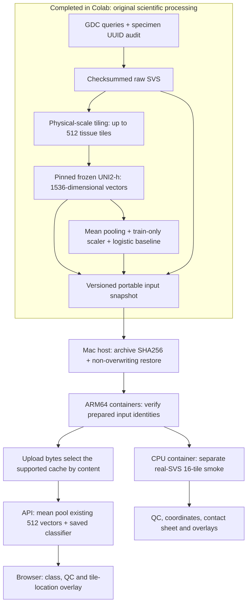

# Pipeline stages, artifacts and execution boundary

The project has a completed upstream scientific workflow and a local workflow
that consumes its versioned prepared artifacts. Caching embeddings is an
intentional interface. The saved classifier computes new probabilities from
those vectors; it does not return the reference answer or train during an
HTTP request.

## Data flow



There is no edge from the new 16-tile smoke to the classifier. The smoke has a
smaller tile limit and thumbnail than the frozen feature-generation config.
The supplied slide's actual model inputs are its existing 512 vectors.

## Stage environments, inputs and outputs

| Stage / source | Execution environment and state | Input → output |
|---|---|---|
| GDC metadata — `lungcancer/gdc.py:discover` | Executed in Colab using GDC HTTPS; not verified as a Docker acquisition service | Project/SVS/open-access query → API mapping, release/status, exact query, paginated raw responses, normalized manifest and audit in `artifacts/discovery/` |
| Specimen resolution and strict re-audit — `gdc.py`, `scripts/repair_cohort_audit.py` | Executed in Colab | Case/sample/portion/slide UUID chains → specimen labels, ambiguity exclusions, corrected 44-patient cohort and inherited fixed splits |
| Budgeted acquisition — `lungcancer/download.py` | Executed in Colab; not rerun locally | Audited UUID/size/MD5 → managed raw SVS and durable ledger. Existing cumulative total: 5,453,285,795 of 10,000,000,000 bytes |
| Full model preprocessing — `preprocess.py`, `safety.py` | Executed on original slides in Colab | SVS + both MPP axes + frozen preprocessing config → up to 512 physical-scale 224px tissue tiles, coordinates, QC and visuals |
| Frozen UNI2-h extraction — `encoder.py`, `features.py` | Executed in Colab on CUDA; no executed UNI2 Docker path claimed | Real tissue tiles + pinned frozen encoder → float32 `[N,1536]` embeddings, aligned coordinates and provenance |
| Baseline fitting — `modeling.py`, `modeling_run.py` | Executed in Colab; saved model reused locally | Training/validation slide means → training-only scaler, L2 multinomial logistic head, C search, model metadata and `classifier.joblib` |
| Fixed evaluation and original real inference | Executed in Colab; not a new local metric computation | Frozen head + fixed held-out features / original slide → saved metrics, named predictions and inference evidence |
| Portable packaging — `scripts/package_cpu_bundle.py` | Executed in Colab | Retained sample, 44 caches, head/provenance/reference predictions → 187-file archive: 186 checksum-listed files plus `manifest.json` |
| Restoration — `scripts/unpack_cpu_bundle.py` | Mac host, Python standard library | Archive + expected SHA256 → new `local_data/cpu_bundle/`; an existing destination is refused |
| Prepared-data ingestion/validation — `verify_cpu_bundle.py:verify_inventory`, `backend/model.py` | Executed in native ARM64 CPU/API containers | Read-only `/inputs` manifest/files → verified inventory and snapshot/model/cache identities, then trusted saved-head load |
| Preprocessing smoke — `verify_cpu_bundle.py:check_preprocess` | Executed in ARM64 CPU container, offline and Torch-free | Retained `sample/sample.svs` → new **16-tile** QC/coordinate/visual output; not new model embeddings |
| App inference — `backend/app.py`, `backend/model.py` | Executed in ARM64 API container | Streamed bytes → SHA256/size/MD5 → compatible cache → float64 slide mean → saved scaler/head → new named probabilities and job JSON |
| Frontend — `frontend/`, nginx | Node 24 build; ARM64 nginx runtime, explicit HTTP mode | Browser upload/poll through same-origin `/api` → real result/error and served JPEG location overlay |

Validating/restoring a prepared snapshot is the local ingestion operation; it
does not rerun GDC acquisition. The real smoke verifies containerized
OpenSlide/QC behavior. Its outputs and cached inference are separate branches
of the same prepared-input workflow. A one-command replay does not establish
fresh raw-SVS → UNI2 → prediction container execution.

## Stable artifact interface

Current run: `20261020T0220Z-audit2`.

| Identity | Value |
|---|---|
| Archive SHA256 | `c7681d5965a9fb318f07c87f109d77ee740b12a323e500734e522c01d16ee988` |
| Data snapshot | `f9491fe4d35f30267df95d26c61d6bb325908694e6df7d746a6acb9826eddb24` |
| Model ID | `42af9fb3f51e1539d994af4f20e2980e4118eac6a8cd665aeb372c1440b2fed5` |
| Classifier SHA256 | `c4bf98706e52febb1fe80ac5baeec75748511c6e1d835b272d19c3570647a71d` |
| Split ID | `964f3b6c073863efbe38b560cfe93b2783cff5d822c64bde12f71241a7a4f2c4` |
| Encoder ID | `debc5e8769258a2e970772801d440debc2500868f5a6cf93b7b5c0c8c1e41324` |
| UNI2-h revision | `d517a8dd47902dd7c308b3c36f63bce47e7b9a43` |

```text
local_data/cpu_bundle/
  manifest.json
  sample/sample.svs
  run/model/model.json
  run/model/classifier.joblib
  run/cohort.json
  run/splits.json
  run/evaluation_validation/predictions.json
  run/evaluation_test/predictions.json
  slides/<file_uuid>/embeddings.npz
  slides/<file_uuid>/embeddings.json
  slides/<file_uuid>/coordinates.npz
  slides/<file_uuid>/preprocessing.json
```

The source checksum selects the cache; it is not a model feature. Filename,
case ID, diagnosis, project and split labels are not prediction inputs. Any
unsupported content gets a clear error and no class. One supplied slide is
enabled in the app.

## Build/start and outputs

After [reviewer setup](REVIEWER_SETUP.md), from the repository root:

```bash
make ms2-demo
```

The host runner orchestrates three native ARM64 images:

| Component | Recipe and dependency specification | Runtime I/O |
|---|---|---|
| CPU verifier/preprocessor | `containers/cpu/Dockerfile`, `containers/cpu/pyproject.toml`, frozen `uv.lock` | `/inputs:ro` → `/outputs`; runtime network disabled |
| API classifier | `containers/app/backend.Dockerfile`, `backend/pyproject.toml`, frozen `backend/uv.lock` | `/inputs:ro`, temporary upload storage → `/work/jobs`; internal Compose network |
| Web | `containers/app/frontend.Dockerfile`, `frontend/package-lock.json`; digest-pinned Node/nginx | Built HTTP frontend, same-origin API proxy; default host `127.0.0.1:8080` |

Each replay creates an ignored `local_outputs/ms2/<UTC>-<id>/` containing:

```text
demo.json                    # status, source/runner hashes, stages, image IDs
app-start.txt                # actual build/start output
cpu-build.txt
preprocess.txt
preprocessing/               # inventory/runtime report, real smoke, QC visuals
job-submitted.json
prediction.json              # actual HTTP job/result
analyzed_tiles_overlay.jpg   # 512 cached model-coordinate locations
```

API job JSON is separately under `local_outputs/app/jobs/`. Trusted inputs are
read-only and are not baked into images. Original query history and scientific
run outputs live in the historical Colab Drive project; those are not Mac
directories to create. [Checkpoint 16](checkpoints/2026-10-20-16-modeling-results.md)
and [the technical overview](TECHNICAL_OVERVIEW.md) document their provenance.

[Selected original evidence](evidence/ms2/2026-10-20/README.md) establishes the
bounded replay, real CPU preprocessing/cache checks and genuine browser flow.
A fresh setup test is distinct from another person actually executing it; the
reviewer guide records its scope. Full fresh-UNI2 container execution remains
pending. No retraining or fresh encoding is required at every app request.
