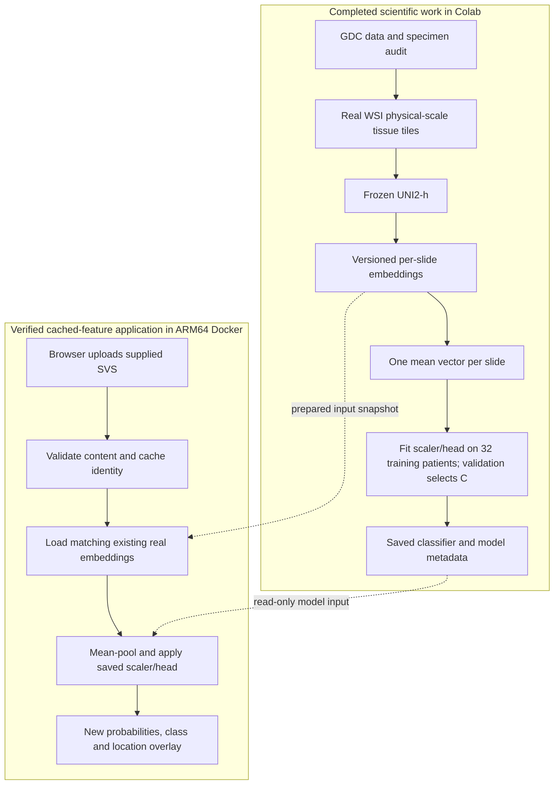

# Technical overview: data, model and application

This document explains the implemented MS2 system, the decisions behind it,
and the scope of the saved execution evidence. It is current at checkpoint 30,
October 20, 2026. Source links and recorded artifacts support the descriptions;
reading it does not require running the pipeline or obtaining private inputs.

Start with sections 1–3 for the architecture, sections 4–7 for data/modeling,
sections 8–9 for serving/containers, and sections 10–12 for verification,
reproduction and the source map. The [design record](MS2_DESIGN.md) compares
MS1 and MS2; [setup/submission instructions](MS2_SUBMISSION.md) and the
[evidence index](evidence/ms2/2026-10-20/README.md) provide commands and proof.

Older checkpoint entries preserve their historical state. Current status
supersedes earlier pending-training/pending-app statements; historical
acquisition/training commands are not new instructions to run those stages.

## 1. Project overview

We classify a lung whole-slide image into three specimen classes:
`non_tumor`, `adenocarcinoma` and `squamous`. A whole-slide image is a very large
microscope scan, usually stored as an SVS file with several image resolutions.
The current project is an engineering research prototype with a small,
metadata-labeled cohort.

The completed scientific pipeline selects tissue tiles at a consistent
physical scale, passes those tiles through the pretrained **frozen UNI2-h**
encoder, averages their feature vectors into one representation per slide,
and trains a regularized logistic regression classifier. UNI2 was not trained
or fine-tuned by this team. The scaler and logistic classifier are the fitted
baseline components.

The Mac application uploads one supplied, previously processed slide. Its byte
contents identify a verified feature cache. The backend applies the saved
scaler/classifier to those real cached features and computes a new prediction.
This actual browser/backend interaction runs in native ARM64 containers.

A concise description is: “We built and evaluated a specimen-
audited, frozen-feature baseline, then containerized a bounded application
that serves the saved classifier over versioned real embeddings.”

## 2. What changed from MS1, and why

MS1 proposed a broader product: technician review, pathologist comparison,
uncertainty handling, editable reports, explanatory heatmaps and later cloud/
external-validation work. Its own milestone table places the containerized
pipeline and application skeleton at MS2. The user reports that the TF
approved MS1 and permitted a simpler MS2 MVP.

The current app keeps the recognizable upload → slide view → analysis panel
flow. It supports one genuine preprocessed slide and displays a class, model
identity, real tile count and quality warnings. Multiple roles, report editing,
calibrated abstention and tumor attribution are deferred. This is a substantial
functional reduction from the eventual product, with a deliberate runnable
scope for this milestone. See [the original mock-up and comparison](MS2_DESIGN.md).

Present the relationship explicitly. A location overlay is not the promised
explanatory tumor heatmap; unsupported-input rejection is not confidence-based
abstention; and the skeleton is not a deployed clinical service. The records
support the implemented subset without making those larger claims.

## 3. Encoder weights, feature caches and the saved classifier

| Artifact | Meaning here | Reused across inputs? |
|---|---|---|
| Encoder weights | UNI2's pretrained parameters; they convert tissue images into vectors | The same frozen weights can encode many slides; they are not in the Mac CPU images |
| Feature cache | Numerical vectors and aligned tile coordinates for a particular slide | Reused for that exact slide under matching preprocessing/encoder identities |
| Saved classifier | The fitted StandardScaler and logistic regression parameters in classifier.joblib | The same saved head can classify compatible slide vectors |

A prediction is a fourth artifact: the output computed from features and the
classifier. The backend computes it on each successful job; it does not serve
a previously saved answer. Frozen reference predictions are used by test/replay
code as correctness checks, not by the backend to choose an answer.

Caching is appropriate because feature extraction is expensive and its result
is reusable when the source bytes, coordinates, configuration and encoder are
unchanged. An uploaded filename is not enough to establish that identity.
SHA256/MD5 identify which existing cache is eligible; checksums are not numeric
inputs to the classifier.

The separate Docker preprocessing smoke also reads the existing raw slide and
produces real tile locations/visuals. Its 16 newly selected tiles do not feed
UNI2 or replace the cached 512 model tiles in the diagram.
The smoke's fewer-than-32-tiles warning is expected with that 16-tile cap; it
does not describe the 512-tile classifier input for the supplied app sample.

## 4. Data: specimen identity comes before modeling

The raw source is open-access GDC/TCGA lung histopathology. Discovery records
the query, timestamps, raw API responses, file UUIDs, sizes and GDC MD5 values.
The code resolves the file's associated specimen through the nested
case → sample → portion → slide UUID relationships.

The label mapping is:

| Actual linked specimen | Project | Task label |
|---|---|---|
| Solid Tissue Normal | TCGA-LUAD or TCGA-LUSC | non_tumor |
| Primary Tumor | TCGA-LUAD | adenocarcinoma |
| Primary Tumor | TCGA-LUSC | squamous |

A patient with cancer can contribute a normal specimen. The patient's cancer
diagnosis therefore does not make their normal slide tumor-positive. Labels
come from the actual file-associated specimen, with diagnosis/project checks
used to catch conflicts. They are not independent pathologist annotations of
every tile, and they do not provide tumor-region segmentation labels.

The audit checks unresolved links, conflicting patient/sample identifiers,
ambiguous specimen chains, preparation evidence, redactions and file access/
checksum metadata. Display barcodes are consistency evidence; their portion
numbers cannot resolve two genuinely distinct portion UUIDs.

Forty-five real slides were processed. A stricter final audit found one
squamous training slide linked through two distinct portion UUIDs. It was
excluded conservatively even though both chains appeared compatible in class.
The remaining **44 slides come from 44 independent patients**. The corrected
model is called **audit2**; the original 45-slide run is preserved as provisional
history. Other patients kept their existing assignments. No replacement slide
was downloaded and no new split was generated.

| Split | non_tumor | adenocarcinoma | squamous | Total patients |
|---|---:|---:|---:|---:|
| Training | 11 | 11 | 10 | 32 |
| Validation | 2 | 2 | 2 | 6 |
| Test | 2 | 2 | 2 | 6 |
| Total | 15 | 15 | 14 | 44 |

The nine inspected pilot patients are all in training. General splitting code
can keep multiple samples/classes from a patient together; this particular
final cohort has one selected slide per independent patient. Tile-level random
splits would let images from the same patient appear on both sides and would
inflate apparent generalization. The saved patient assignments avoid that.

Preparation is a limitation. “Frozen” is inferred from TS/BS categories; there
are **zero explicit Frozen confirmations** in the raw preservation fields.
Forty records say Unknown and four say OCT; is_ffpe=false supports non-FFPE
status without proving freezing. Source-site and preparation differences can
remain confounders even after patient separation.

Downloads use a durable conservative ledger. Before an attempt starts, the
full expected file size is reserved against the unchanged 10,000,000,000-byte
cumulative budget. Transfers are streamed, verified by size/MD5 and can resume
with validated range handling. Already verified raw files are reused. Actual
cumulative raw transfer was **5,453,285,795 bytes**. Only pipeline-owned raw
files are eligible for cleanup after persisted outputs have passed checksums;
user originals and existing private directories are preserved.

Code to navigate: [GDC audit](../lungcancer/gdc.py),
[download accounting](../lungcancer/download.py),
[corrected snapshot](../configs/modeling_snapshot_44_audit2.json),
[audit correction script](../scripts/repair_cohort_audit.py).
The stricter discovery audit's 3,172 eligible files out of 3,220 is a metadata
pool, not a claim that thousands of slides were downloaded or trained on.

## 5. Preprocessing: consistent scale and bounded resources

OpenSlide reads image regions from the WSI pyramid. We do not resize an entire
gigapixel image into RAM. Both `openslide.mpp-x` and `openslide.mpp-y` must be
valid. MPP means micrometres per pixel; a consistent physical field of view is
more meaningful than treating all scanners' pixel dimensions as equivalent.
Objective-power metadata is recorded but does not replace missing MPP.

The frozen model configuration targets approximately **0.5 MPP**, **224 × 224**
output pixels and at most **512** tiles. A tile therefore covers approximately
112 micrometres in each direction; actual output MPP is recorded after integer
rounding/resampling. The code chooses a pyramid level fine enough for that
output and converts coordinates per axis. Saved X,Y positions are the upper-
left tile corners in **level-0 pixels**, irrespective of read pyramid level.

A thumbnail drives a simple tissue mask. HSV thresholds retain sufficiently
saturated pixels with brightness between 0.15 and 0.98; one small binary
closing and removal of tiny components clean the mask. The grid is physical-
scale and non-overlapping. A candidate passes if at least 50% of its mapped
thumbnail region is tissue. Airspaces are retained as holes rather than filled
as tissue. When more than 512 candidates pass, deterministic farthest-point
sampling spreads the selected locations across tissue fragments; the selected
indices are then stored in a fixed reading order. The seed is 215.

This is a basic tissue/QC workflow, not comprehensive pathology artifact
filtering. It does not perform stain normalization, learned segmentation or
blur detection. Sparse normal lung can fail a high coverage threshold because
alveolar airspaces occupy much of a tile. Coarse thumbnail masks can also be
imprecise. These limitations are recorded rather than hidden by changing
thresholds after looking at held-out results.

The thumbnail safety wrapper refuses an unsafe decode when no bounded pyramid
level is available. Where possible it reads an existing coarser level with at
most 64 million pixels and records/version-controls that fallback. Its use of
`unittest.mock.patch` is a narrow implementation hook around OpenSlide's
thumbnail method; the pixels still come from the real slide. It does not
substitute synthetic tissue or predictions.

Saved outputs include the thumbnail, tissue mask/overlay, sampled-location
overlay, representative tile contact sheet, aligned coordinates and a JSON
record of scale, counts, configuration, warnings and fingerprints. RGBA tiles
are composited onto white. Embedded ICC colour profiles are recorded as
unapplied. That warning establishes an unapplied profile; by itself it does
not prove a deployment-versus-training colour mismatch or a failed prediction.

Code: [preprocessing](../lungcancer/preprocess.py),
[memory guard](../lungcancer/safety.py),
[model configuration](../configs/preprocessing.json).

## 6. Feature extraction and cache integrity

UNI2-h is a pretrained pathology vision transformer. The completed GPU run
loaded a pinned revision and recorded the weight checksum, architecture and
official evaluation transforms. The encoder was set to evaluation mode,
gradients disabled, and inference performed in float32. Batch size began at
16 and could halve on GPU memory pressure. The current extractor implementation
requires the approved CUDA path; a native Mac CPU cache check does not exercise
that CUDA encoder implementation.

Each real tile becomes a **1536-dimensional** feature vector. Forty-three
eligible slides have arrays shaped [512,1536]; one has [467,1536], totaling
**22,483 finite vectors**. Each row is paired with its tile's [x,y] coordinate.
Feature NPZ loading disables pickle and validates shape, nonempty data, finite
values and the coordinate fingerprint.

Cache reuse depends on source identity, preprocessing implementation/config,
encoder identity, coordinate identity and feature-extraction implementation.
Reusing the same filename after changing one of those ingredients is not
enough. The verification code checks array/file hashes, metadata fingerprints,
coordinate order and slide bounds before reuse. The bounded application pins
the known input snapshot, model, classifier, split, encoder and supported raw
slide identities.

The private portable snapshot has 187 files: manifest.json plus 186 checksum-
listed entries. It includes the raw demo slide, all 44 caches, the saved model,
cohort/splits and frozen prediction references. It excludes UNI2 weights and
credentials. Its identifier is a provenance identity, distinct from the Git
commit, archive checksum, image ID and model ID; each identifies a different
artifact. [The replay report](evidence/ms2/2026-10-20/demo/demo.json) records
the actual snapshot, raw source, model and container identities together.

Code: [encoder](../lungcancer/encoder.py), [features](../lungcancer/features.py),
[verify_cache](../lungcancer/modeling_run.py),
[portable-bundle verifier](../scripts/verify_cpu_bundle.py).

## 7. Training, selection and results

The classifier sees **one vector per slide**. If a slide has N tile vectors
e_i, its representation is their componentwise mean: `x = sum(e_i) / N`.
Pooling accumulates in float64. Averaging is cheap, accepts different tile
counts and creates a simple first baseline. It loses spatial arrangement and
can dilute small focal abnormalities; it is not attention-based MIL.

There are 32 independent training examples, each with 1536 features. The
22,483 tile vectors are not 22,483 independently labeled training patients.
This small-sample/high-dimensional setting motivates a frozen representation
and regularization rather than claiming that a larger fitted network is
automatically better.

The scikit-learn pipeline first fits StandardScaler on **training slide means
only**. Conceptually, each feature is transformed as
`z_j = (x_j - training_mean_j) / training_scale_j`, with constant-feature cases
handled by the library. Validation, test and runtime data use those saved
statistics. Fitting the scaler on all 44 slides would leak held-out
distribution information even without using held-out labels.

The second step is three-class multinomial logistic regression with L2
regularization, `solver='lbfgs'`, `max_iter=3000`, `random_state=215` and selected
**C=0.01**. Smaller C means stronger regularization. The prespecified search
was C ∈ {0.01,0.1,1.0}, selected by validation macro F1. All three had validation
macro F1 0.667; the implementation keeps the first best value on a tie, so
0.01 remains selected. Test embeddings are not opened by the selection code.
The trained pipeline is saved in classifier.joblib with model.json provenance.

For each class c, the learned head calculates a linear score
`s_c = w_c · z + b_c` from the standardized slide vector. Softmax converts the
three scores to probabilities that sum to one:
`p_c = exp(s_c) / sum_k(exp(s_k))`. Training fits those weights/intercepts with
a multinomial loss and L2 penalty. C is a regularization parameter, not a
confidence threshold or a learning rate. The saved probabilities are not
calibrated estimates of clinical reliability.

`named_probabilities` explicitly reorders the library's class columns into
`non_tumor`, `adenocarcinoma`, `squamous`. Relying on an assumed alphabetical
order could attach the correct number to the wrong diagnosis label.

| Saved evaluation | Macro F1 | Balanced accuracy | Interpretation |
|---|---:|---:|---|
| Validation, 6 patients | 0.667 | 0.667 | Four correct, with the two tumor classes confused once each |
| Test, 6 patients | 1.000 | 1.000 | Two correct per class, with very small and previously inspected test counts |
| Training-majority reference on these balanced held-out sets | 0.167 | 0.333 | A simple comparison point, not a useful classifier |

Precision is the fraction of a predicted class that is correct; recall is the
fraction of the true class found. F1 combines precision/recall; macro F1 gives
each class equal weight. Balanced accuracy averages class recall. Confusion
matrix rows are true classes and columns predicted classes in the explicit
order above. Undefined metrics are recorded explicitly instead of being
presented as meaningful zeros or fabricated probabilities.

The six test patients were evaluated in the earlier provisional 45-slide run
before the metadata-only audit correction. No test-based model choice was
made, but we cannot describe the corrected test as pristine and never seen.
Perfect results on six patients do not establish robustness, clinical accuracy,
calibration or external generalization. Site/preparation confounding, sparse-
normal selection and metadata-derived labels remain limitations.

Original metadata and validation search:
[saved training record](evidence/ms2/2026-10-20/model/saved-training-metadata.json).
Final result context: [checkpoint 16](checkpoints/2026-10-20-16-modeling-results.md).
Code: [training/evaluation](../lungcancer/modeling.py).
No new training or metric computation is needed to study those results.

## 8. What happens when someone clicks Analyse

The frontend's production Docker build explicitly selects HTTP mode. In
development, the default is mock mode; simply opening a development page is
therefore not evidence of a real backend. The Compose web image bakes in
`VITE_INFERENCE_MODE=http` and `/api` as the browser-facing API base.

The actual request flow is:

1. The browser streams one selected SVS as multipart field `slide` to
   `/api/jobs`. nginx proxies this to `/jobs` on the internal API.
2. The server checks upload bounds and extension, hashes the bytes in chunks
   and submits a generated job ID. Filename and optional case_id are not
   classifier inputs. The filename extension is only an upload-format check.
3. The worker compares source SHA256, MD5 and byte count with the supported
   sample and revalidates its selected real cache. Unknown/modified content
   fails with no result class.
4. Real embeddings are loaded, mean-pooled and passed through the saved
   scaler/classifier. The result contains explicit named probabilities,
   `probabilities_calibrated: false`, class, tile count, warnings and provenance.
5. The browser polls the job and displays its genuine terminal result or error.
   It obtains the analyzed-location JPEG through a browser-accessible API URL.

Startup verifies all manifest entries and model/cache identities before trusted
joblib deserialization. Joblib is not a safe general format for arbitrary
untrusted uploads; this app loads only the fixed, checksummed trusted model.
It never accepts a model file from the user. The lightweight dependency graph
can import feature/cache helpers without constructing UNI2: Torch imports are
lazy inside the encoder constructor, and the CPU app rejects a Torch-present
environment rather than silently taking a fresh-encoding path.

| Browser route | Purpose |
|---|---|
| GET /api/health | Ready status, supported mode and model/snapshot identities |
| POST /api/jobs | Bounded upload; returns 202 with generated job ID |
| GET /api/jobs/{id} | queued, running, done or failed state |
| DELETE /api/jobs/{id} | Cancellation represented as failed with a clear reason |
| GET /api/jobs/{id}/overlay | Real overlay for a successful current-session job |

One worker performs classification; uploads are gated one at a time. File size
is capped at 80,000,000 bytes and the entire multipart body at 82,000,000 bytes.
The upload spools into bounded temporary storage and is discarded after hashing.
Jobs use generated paths, not user filenames. At most four active jobs and the
latest 100 in-memory job records are retained; output JSON stays on disk.
After an API restart, old IDs are not restored to HTTP lookup, so upload again.
This is a local demonstration, not a durable distributed job service.

For the supplied `sample.svs`, the verified result is `non_tumor`, with 512
tiles and probabilities approximately 0.950990 / 0.019204 / 0.029806 in explicit
class order. The UI hides probabilities and shows the ICC warning. Red
rectangles mark analyzed locations; there are no learned tile-level tumor
attributions in this mean-pooling baseline. The JPEG overview is not a full
interactive gigapixel viewer. Identical bytes renamed to another .svs filename
produce the same result. A new slide needs its own compatible features, but
the current application deliberately supports only the supplied cache mapping.

Code: [backend model](../backend/model.py), [HTTP jobs](../backend/app.py),
[HTTP adapter](../frontend/src/api/adapters/httpAdapter.ts),
[polling](../frontend/src/api/runAnalysis.ts),
[viewer mapping](../frontend/src/features/viewer/useViewerSource.ts).

## 9. Containers, networking and reproducibility

Docker Desktop supplies a Linux environment on the Apple M1. Containers build
and run as **linux/arm64**; the verifier reports **aarch64**, another naming
convention for the same architecture family. This is not an x86 emulation run
or a separately provisioned cloud deployment.

`compose.app.yml` starts API and web services. Web serves the built React app
through nginx; API runs FastAPI/uvicorn with the compatible NumPy/scikit-learn
stack. The Python API and separate CPU verifier each have a pyproject.toml and
uv.lock. Frontend uses package.json/package-lock.json and npm ci. Python uv
manifests are not Node dependency manifests. Base images have pinned identities;
image-build dependencies may need network even when the processing runtime is
offline. The root GPU project's manifest is separate from the isolated proven
CPU lock; no full locked GPU container execution is claimed.

Only the web port is published, at `127.0.0.1:8080`. The browser sends same-
origin `/api` requests; nginx resolves the internal Docker name `api:8000`.
A user's browser cannot resolve the container name `api`, and localhost inside
the web container would refer to web, not API. API's network is internal;
web also joins an ingress network so the host port can actually be published.
Vite settings are compiled into the frontend bundle: setting an environment
variable after that build would not rewrite the browser's API URL.

The original browser test found ECONNREFUSED despite healthy containers because
an internal-only network did not expose the expected host mapping. Adding web
ingress and checking the actual host-facing API route fixed that real failure.
nginx now returns clear unavailable/oversize JSON, and the UI has no mock
fallback when the backend is down.

Trusted inputs mount read-only at `/inputs`; output JSON/overlays go to a
separate writable bind mount; uploads use temporary storage. Container roots
are read-only and processes use unprivileged/host-mapped users. No raw slide,
classifier, embeddings, HF authentication or UNI2 weights are baked into the
images. No HF/cloud credentials are required for this local cached demo.
Colab used supported HF authentication for the gated encoder; do not display
or redistribute those credentials/weights during a repository walkthrough.

Code/config: [app Compose](../compose.app.yml),
[CPU Compose](../compose.cpu.yml), [nginx](../containers/app/nginx.conf),
[API Dockerfile](../containers/app/backend.Dockerfile),
[web Dockerfile](../containers/app/frontend.Dockerfile),
[CPU Dockerfile](../containers/cpu/Dockerfile).

## 10. Exactly what was verified

| Evidence | What it establishes | What it does not establish |
|---|---|---|
| 29 CPU unit tests | Audit, geometry, cache, split, classifier/failure logic on focused fixtures | Generalization on real patients |
| 44 real caches / 22,483 vectors | Finite aligned arrays, provenance, patient separation, training-only scaler and 12 frozen reference matches | Fresh encoder execution in Docker |
| Real 16-tile preprocessing smoke | OpenSlide, actual slide scale/masking/coordinates and saved visuals work in ARM64 Docker | New features for the trained model |
| 14 backend tests | Real saved-head reference plus corrupt/unknown inputs, bounded requests, cancellation and error behavior | A multi-user production service |
| Frontend type/lint/build | Production bundle compiles with explicit HTTP configuration | A browser-to-backend success by itself |
| 10 real browser/API scenarios | Actual upload/poll/result; renamed/case invariance, modified/unknown input, fixture isolation, bounds and outage recovery | Arbitrary-slide support or clinical validity |
| make ms2-demo, exit 0 | One executed bounded sequence: start, input verification, real smoke, actual HTTP inference, reference/overlay/image identities | A fresh UNI2 path or retraining at runtime |

Unit fixtures are intentionally synthetic to exercise failure conditions and
invariants; they are labeled as such. The real caches, raw-slide preprocessing,
saved classifier and actual browser results are separate genuine evidence.
Browser tests did not intercept network requests to supply fake predictions.
An actual API stop/restoration tested the outage path.

The original CPU reference differences were at most 5.56e-17; the real app/
replay difference was about 6.94e-18, both below the 1e-8 tolerance. These are
agreement checks against frozen outputs, not new patient-performance metrics.
The 29 CPU tests recorded three fixture/deprecation warnings and the backend
suite one test-client warning, with no failed/skipped tests in those runs.

All selected logs, JSON/JUnit, original Docker screenshot, model metadata,
preprocessing visuals and real browser screenshots are indexed in
[the evidence package](evidence/ms2/2026-10-20/README.md). File hashes and any
local-path substitutions are recorded. The full fresh-UNI2 container path
remains explicitly pending in [the verification matrix](VERIFICATION_MATRIX.md).

## 11. Running and recovering without changing scientific state

The current Mac already has the private bundle. For a live UI use
`make app-up` and http://127.0.0.1:8080/, selecting
`local_data/cpu_bundle/sample/sample.svs`. `make app-stop` and
`make app-resume` preserve bind-mounted outputs. `make ms2-demo` is the tested
noninteractive bounded replay; it creates a fresh ignored output directory and
preserves the prior runs. The new preprocessing stage remains separate from
the immutable cache used for its HTTP prediction.

A fresh teammate checkout also needs the existing authorized portable archive;
Git does not include private model/cache binaries. The restore helper verifies
the archive checksum and refuses an existing destination. Use the exact
[setup/submission instructions](MS2_SUBMISSION.md), not replacement downloads.
Tests are already saved; reading the records does not require rerunning them.
New real training, downloads, weights, split/config changes and profiling are
outside the current documentation task.

Persistence has several layers: GitHub stores source and selected sanitized
evidence; ignored local directories store private inputs/bulk outputs; verified
source archives and Git recovery bundles protect the checkout. Earlier approved
CPU evidence was also mirrored to Drive. The Colab persistence helper requires
a genuine mounted Drive and correctly refuses on the Mac; current new private
backups are local and are not claimed to be newly synced to Drive.

The original push of the larger evidence package failed with HTTP 400. A normal
retry with temporary HTTP/1.1 and a larger POST buffer succeeded; no force push,
TLS/authentication change or reset was used. Live full-SHA comparison and
fresh-clone byte comparisons verified publication/recovery. An image ID,
source-backup checksum and Git commit serve different recovery purposes and
should not be substituted for each other.

## 12. Source map

| Area | Main files | Question it answers |
|---|---|---|
| Label audit/acquisition | lungcancer/gdc.py, download.py | Which specimen is this, and were its exact bytes acquired within budget? |
| Physical preprocessing | preprocess.py, safety.py, configs/preprocessing.json | Which real pixels/locations were selected safely and at what scale? |
| Frozen representations | encoder.py, features.py, modeling_run.py | Which encoder/config made these vectors, and is reuse compatible? |
| Learned baseline | modeling.py; saved-training-metadata.json | What was fitted on which patients, and how was C chosen? |
| Real served inference | backend/model.py, backend/app.py | How is a supported upload resolved and classified without filename shortcuts? |
| Browser integration | frontend/src/api/, state/, features/ | How do real jobs become a result or useful error in the UI? |
| Runtime packaging | Compose files, containers/, uv/npm locks | How are processes, mounts, ports and exact dependencies arranged? |
| Demonstration/testing | scripts/run_ms2_demo.py, verify_cpu_bundle.py, frontend/scripts/test-app.mjs | What was actually executed, with which scope and outputs? |
| Current evidence | This overview and the evidence index | Which artifacts substantiate the implementation and results? |
